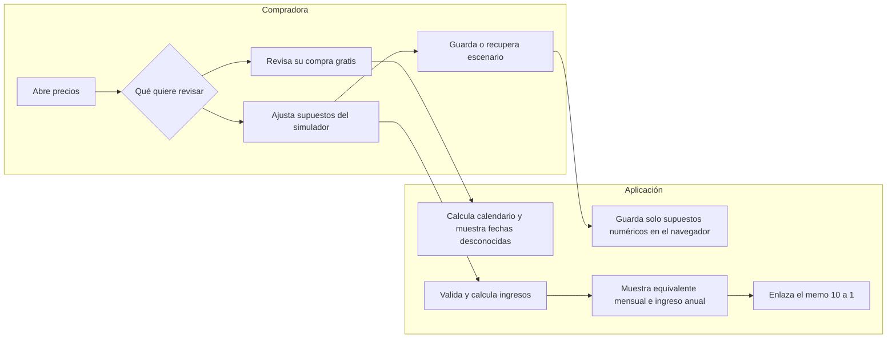

# Debt Check MX · Week 14

## Problema y usuario

Una compradora en México quiere ver cómo una lavadora de $12,000 MXN a 12 meses sin intereses se cruza con las mensualidades del celular y el seguro semestral. Una entrevistada reportó unos 20 minutos entre Notas y cálculo mental para una compra. Falta medir cuánto dedica a repetir esa tarea y cuánto ahorra al reabrir un escenario. La usuaria y pagadora de la oferta es la misma persona: una compradora recurrente con otra compra pendiente. La compradora ocasional puede completar la revisión gratis.

## Resultado antes del cierre

En el dominio de entrega, /pricing presenta dos niveles, /pricing permite ajustar y guardar supuestos de ingresos, y /about contiene el memo 10:1. Una persona sin sesión puede abrir estas páginas y completar el chequeo de compra. El test registra una respuesta real al precio y su motivo. La oferta de $39 MXN cubre 12 meses de reutilización y sigue en evaluación. El chequeo gratuito incluye el calendario, los subtotales parciales y las obligaciones sin fecha.

## Mockup

La página muestra ambos niveles, el estado experimental de la oferta y un simulador con controles de volumen, conversión y precio. El boceto agrupa los niveles a la izquierda y el simulador a la derecha. La interfaz final separa ambos niveles en tarjetas para aclarar qué incluye cada uno.

## Flujo

## Benchmark y localización

El brief seleccionó Apple Numbers como comparación directa para reutilizar una hoja y YNAB como referencia de calendario recurrente. Debt Check MX adapta ese flujo a pesos y meses sin intereses, mantiene visible una obligación sin fecha y compara el mismo trabajo con Notas/Numbers durante 12 meses.

## A tres años

Debt Check MX podría convertirse en un calendario reutilizable de compromisos de compra para hogares mexicanos. Cada cambio de fecha o importe conservaría su estado de confirmación. La oferta pagada dependería de que la reutilización ahorre trabajo medido y sostenga el costo de servicio.

## Alcance

El lanzamiento incluye contenido público, simulador, escenarios numéricos locales y memo. El experimento de reutilización de calendarios requiere verificar por separado el guardado con sesión de Week 13. Quedan fuera el cobro en línea, la sincronización bancaria y las estimaciones de riesgo sin observación.

| Componente | Implementación |
| --- | --- |
| Sitio | Extender el proyecto Next.js existente |
| Cálculo | Compradoras elegibles en 12 meses × conversión × precio de 12 meses. Dividir entre 12 para equivalente mensual |
| Escenarios | Guardar entradas numéricas validadas en el navegador |
| Datos personales | Mantener autenticación y RLS para calendarios privados del producto |
| Economía del servicio | Restar adquisición, onboarding, soporte, correcciones y excepciones del precio para estimar contribución. Registrar costos antes de afirmar margen |

## Pruebas

- Revisar /pricing, /about, /product y enlaces de evidencia sin sesión. Verificar el dominio de entrega.
- Con 100 compradoras, conversión hipotética de 5% y $39, esperar $195 anuales y $16.25 mensuales equivalentes. Probar cero, límites, valores inválidos y recuperación tras recargar.
- Repetir lavadora/celular/seguro en Notas o Numbers y en el producto con el mismo encargo. Cronometrar creación y reutilización por separado. Verificar 12 cargos y subtotal parcial mientras falta la primera fecha.
- Hacer prueba de persona sintética con capturas y registrar un punto de confusión, cambio y verificación.
- Entrevistar a una compradora potencial. Registrar oferta, respuesta, razón y decisión. Una respuesta verbal no cuenta como pago.

## Regla 10:1

$39 × 10 = $390 MXN de beneficio incremental en 12 meses. Beneficio = horas ahorradas × valor por hora + costos directos evitados + pérdidas evitadas respaldadas por evidencia, sin duplicar rubros. Como sensibilidad, a $120 MXN por hora supuestos, se requieren 195 minutos ahorrados al año si todo el beneficio viene del tiempo. Los 20 minutos reportados describen el proceso actual para una compra y el ahorro sigue sin medirse. Si la reutilización no mejora el proceso habitual o la compradora rechaza la oferta porque el chequeo gratuito basta, registrar el motivo y replantear el cobro.
