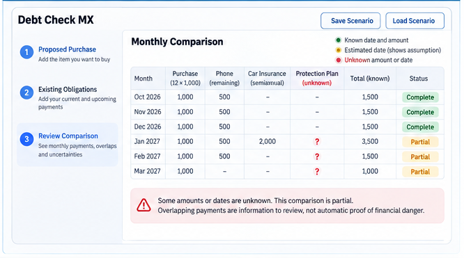
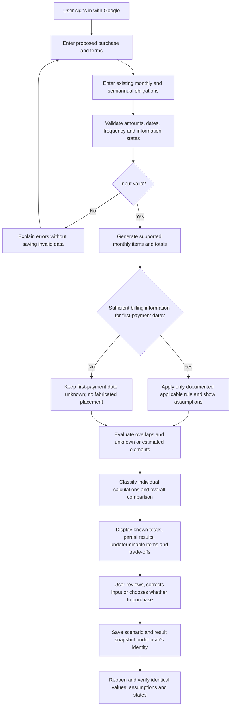
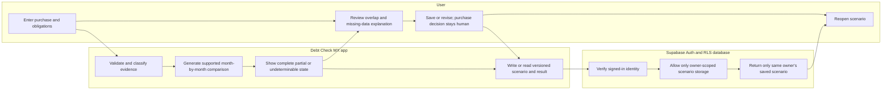

# Debt Check MX — Week 12 Product Packet

**Founder:** Ana María Matas | **Status:** Phase 5 conditionally approved; corrections integrated; Phase 6 audit complete; explicit pre-code approval still required  
**Related:** `docs/CHARTER.md` (approved), `docs/PERSONAS.md` (finalized); Week 12 Method, Verdict, Team Blueprint  
**Venture:** Week 10 — Isle of Happiness | **Method:** Prevent the Loss

## 1. Problem, exact user and evidence

**Problem in plain English:** Before an installment purchase, a person may be unable to see which monthly and semiannual commitments will coincide. Missing amounts and first-payment dates can make the comparison incomplete. An overlap is something to review, **not proof of harm or unaffordability**.

**Exact initial user:** An adult in Mexico considering an installment purchase, with other commitments, willing to enter information manually. Persona 1 is the **anonymized real October 2026 washing-machine participant**; Persona 2 is an **explicitly hypothetical irregular-income buyer with uncertain first-payment timing**. Neither is a fabricated interview.

**Real case:** MXN 12,000 replacement washing machine, 12 MSI of MXN 1,000; about five phone installments remain; semiannual car insurance due January; protection plan timing uncertain; first card installment date unclear. The real participant reported ~20 minutes of Notes and mental planning and three days to decide. Unknown: exact purchase date, phone and insurance amounts, charge amount and due date, card rules, controlled timing, willingness to pay. A single case does not prove market demand. No 10× result is supported.

## 2. One full feature and definition of success

**One feature:** Enter a proposed installment purchase and existing/upcoming obligations → calculate a transparent month-by-month view with supported known totals, explicitly qualified estimates and unresolved unknowns → explain overlapping commitments and trade-offs without an affordability judgment → **save and reopen the complete scenario**.

**Before the module closes, X works:** At the real venture domain, a user authenticated with Google can enter a synthetic purchase with monthly and semiannual obligations; see a month-by-month comparison with complete/partial/undeterminable states and known/estimated/unknown values; understand why dates/amounts are unresolved; save the scenario in Supabase and reopen it without losing any inputs, calculations, assumptions or uncertainty states. This is a **planned acceptance threshold**, not a delivered function.

**North Star (unchanged Charter definition):** Percentage of complete comparison tasks in which the user correctly identifies known payment overlaps **and unresolved limitations** in a predefined scenario before deciding. One task passes only if all specified overlaps, combined known amounts/timing (when supportable), and all required limitations and result states are understood; the purchase decision is not graded. Record complete-task time and accuracy versus Notes/Excel as supporting metrics. No target percentage or speed improvement has been measured or promised.

## 3. Image-generated mockup

**Status: concept illustration, NOT a screenshot or real app.** Every amount, month, first-payment placement, insurance amount, status label, and calculated total in the illustration is **synthetic** and is **not supported as Renata's actual data**. In particular, the image does not establish Renata's January insurance amount or her first washing-machine payment date. Some illustrated rows say “Complete” despite uncertain charges elsewhere: these labels are NOT authoritative and must NOT be copied into the app. Generated labels and arithmetic are not specifications. Only the written Packet, rules and acceptance tests below govern implementation. The layout concept is: proposed purchase + obligations input, month-by-month table, explicit status/assumptions, visible unknowns, and save/reopen. **The implemented UI must be in Spanish (including statuses and explanations), with MXN values.** This repository image must remain located at `docs/DEBT_CHECK_MX_MOCKUP_CONCEPT.png` so the relative link above resolves from `docs/PACKET.md`. Before implementation, check visual labels for correctness and accessibility.

## 4. Feature flow — Mermaid

### Actor swimlane — required because User, Application and Database are separate actors

## 5. Real benchmark and differentiation hypothesis

**Strong existing functional benchmark: YNAB scheduled transactions.** Official July 10, 2026 documentation describes upcoming and repeating transactions, including **twice a year/every six months**, and use of upcoming transactions when planning. [YNAB scheduled transactions (official)](https://support.ynab.com/scheduled-transactions-a-guide-BygrAIFA9?mobile-help=true). YNAB already handles recurrence; Debt Check MX must not claim that frequency support is unique.

**Another strong benchmark: Monarch Money.** It provides a recurring-bills calendar and bill tracking; official pages describe future recurring charges and synced balances. [Monarch recurring expenses (official)](https://www.monarch.com/blog/track-recurring-bills-and-subscriptions) and [Monarch Bill Sync (official)](https://www.monarch.com/blog/introducing-bill-sync).

**Real user baseline:** Phone Notes and mental arithmetic, as reported by the October participant. Excel or Google Sheets is a flexible manual alternative; their actual performance on this exact scenario has **not** been measured.

**Benchmark line required by Ramsey:** *Best relevant verified existing capability:* YNAB's documented scheduled-transactions system supports future recurring commitments, including six-month obligations. *Proposed local difference:* Debt Check MX concentrates on a **single, Spanish-first, MXN, manual-entry, pre-purchase installment comparison** with explicit known/estimated/unknown evidence and complete/partial/undeterminable outcomes, without requiring bank connection or general budgeting. **This is a differentiation hypothesis, not proof of superior functionality, lower effort, availability, market fit, or 10×.** Direct feature-by-feature and complete-task comparison remains to be tested.

## 6. Three-year long view (three sentences, consistent with Charter)

In three years, Debt Check MX aims to be a trusted pre-purchase financial comparison tool for people in Mexico who use installment payments. It will make monthly and semiannual commitments, uncertain charges and incomplete payment timing easier to understand before a purchase. It will remain transparent and buyer-controlled rather than becoming a bank, lender, or automatic purchase adviser.

## 7. Scope cut — what is in and out

**IN, all part of ONE feature:** Google sign-in; proposed purchase and installment terms; monthly and semiannual obligations; known, estimated and unknown timing/amount states; recurrence and monthly known totals; warning when some values cannot be placed or totaled; explicit complete/partial/undeterminable labels; overlap descriptions without danger classification; results and assumptions; private save/reopen of scenario.

**OUT:** General budget and expense tracking; bank connection; credit or lending; automatic affordability scoring; monthly salary assumption; purchase automation; push notifications; integrations with Gemini or other mandatory AI; credit-card issuer guessing; financial advice; unvalidated return-on-investment/10×; generic analytics dashboards. No extra independent features.

**Approved time window:** Show **12 calendar months by default**, beginning with the **user-selected review month** (inclusive). Clearly identify the first and last month displayed. If a purchase or obligation lasts beyond the displayed period, indicate that payments remain outside the window and that this is **not the full lifetime total**. Do not silently truncate a repayment commitment or describe the 12-month subtotal as the full obligation. If a first payment cannot be placed, display that obligation as unresolved instead of inventing a monthly slot.

## 8. Deterministic business rules, uncertainty and billing dates

### Evidence state versus calculation state

- **Evidence state (per input or generated payment):** `known` = directly confirmed by user data; `estimated` = calculated using explicitly recorded sufficient assumptions and applicable rules; `unknown` = not justified. Source provenance is user-entered or rule-derived, not bank verified.
- **Calculation state (per item/month/result):** `complete` = all information required for the stated calculation exists; `partial` = a supported subtotal exists but at least one relevant element is unresolved; `undeterminable` = the particular calculation cannot be calculated reliably from available inputs. An overall comparison with relevant missing information is partial even when several individual totals are complete.
- **Never** treat `null`, unknown or omitted values as 0; differentiate an actual entered MXN 0 from missing input. Never silently upgrade estimates or unknowns after save/reopen.

### Display contract — separate statuses at three levels

- **Known monthly subtotal (`subtotal conocido`)**: sum **only** supported scheduled amounts for that month. Always label it a *known subtotal*, never a fully inclusive monthly total when some relevant amount or placement is unresolved. An actual confirmed MXN 0 is different from an unknown.
- **Month-level calculation completeness (`estado del mes`)**: `complete` only when every relevant obligation *known to occur in that month* has a supported amount **and** there are no unresolved items that might affect that month; `partial` when a supported subtotal exists but a relevant amount or possible placement is unresolved; `undeterminable` for a particular unsupported monthly computation with no defensible subtotal. An unscheduled obligation with an unknown month is shown **outside the grid** and flagged as a possible limitation to monthly completeness, not invisibly ignored.
- **Overall scenario completeness (`estado global`)**: `complete` only if all relevant obligations and their timing are resolvable **within the declared view** and no unresolved items affect the comparison; `partial` if useful monthly results exist but one or more charges, dates, or remaining outside-window commitments prevent a fully inclusive comparison; `undeterminable` only when the essential comparison itself cannot be reliably produced. The label `complete within 12-month view` must never imply lifetime completeness.
- **Unscheduled obligations (`sin fecha asignable`)**: separate visible section listing amount (if known), remaining count/frequency (if known), reason for missing placement, and the impact on the scenario. Unknown first installment timing must NOT create monthly rows or an invented overlap.
- **Estimated/unknown timing (`fecha estimada` / `fecha desconocida`)**: any supported estimate identifies rule, input source and assumptions; if the basis is insufficient, timing remains unknown. **Version 1 will not estimate issuer-specific credit-card dates.**
- **Display copy:** `Subtotal conocido`, `Mes: completo/parcial/no determinable`, `Escenario: completo/parcial/no determinable`, `Pagos sin fecha asignada`, `Fecha confirmada/estimada/desconocida`, plus visible explanatory sentences; never status by color alone.

### Scheduling

1. Store currency as integer MXN cents, reject NaN, negative charges where inappropriate, and unsafe ranges. Cross-check advertised payment vs purchase price and installment count; explain discrepancies instead of claiming fees without evidence.
2. For **known monthly obligations**, repeat by calendar month from an actual supported start date through the earlier applicable end date or remaining payment count; do not continue finite plans forever. For **semiannual obligations**, repeat every six calendar months from a valid actual anchor date, respecting any end date or remaining occurrence count. Adopt and test an explicit calendar policy for non-existent month-end days (for example, clamp to the final day of the target month) and leap years; never roll an item silently into the wrong month. If no anchor is known, keep occurrence timing unknown. Disclose commitments beyond the 12-month view.
3. A proposed installment purchase has a known amount/count but a monthly placement requires a **confirmed first-payment date** or a genuinely supportable estimate; otherwise leave its timing unknown. The app may show a known *unscheduled* installment amount/count, but must not put it in invented months.
4. For credit cards in **version 1**, accept only a **manually confirmed first-payment date** or an **unknown first-payment date**. Never derive it from closing date alone. Do not implement issuer-specific first-payment estimation without independently verified issuer, purchase/posting and due-date/calendar rules, which are outside this initial scope. Other estimated information, if ever displayed, must retain explicit supported rule and assumptions.
5. For an obligation with **known amount but unknown month**, keep it in an unscheduled list; do not add to a chosen month's known total. For an obligation with **known month but unknown amount**, show it on that month with `amount unknown`; show the subtotal of known components and mark the overall month `partial`. When month AND amount are unknown, keep it in unresolved items, not invisible or zero.
6. Display an overlap when 2+ relevant obligations occur in the same month; identify parties and combined **known** amount with possible unresolved additions. An overlap alone is not harmful, safe, or an affordability determination.
7. Irregular income is out of the automatic affordability calculation; if the buyer has no stable monthly figure, show no artificial average or pass/fail result. The comparison remains useful without entering income.
8. A computation is `undeterminable` when its own required inputs cannot be established. Do not block unrelated known calculations.
9. Clearly state that manually entered data and rule-based estimates are not bank-confirmed records.

## 9. Architecture and minimum stack (proposal; no services created)

| Layer | Proposed technology | Role and limits |
|---|---|---|
| UI/site | Next.js + React + Tailwind | Simple responsive Spanish-first interface; `/`, `/product`, `/about`; accessible date and state labels |
| Pure calculations | TypeScript pure functions, tests | Validated MXN cents, recurrence, partial totals, labels and assumptions; no Gemini |
| Validation | Shared typed schema (e.g. Zod) + server validation | Per-field type, amount, limits, dates; never trust browser state |
| Auth | Supabase Auth, Google provider | Required before storing any user financial scenario |
| Storage | Supabase Postgres with Row Level Security | Owned scenarios, structured raw inputs, rule/assumption versions, results; no public access to another user's records |
| Deployment | Vercel | At real venture-owned domain when user authorizes purchase and connection |
| Source and history | GitHub | Minimum five meaningful commits, two deployments, prompt log; Session Close in `DECISIONS.md` |

**Public site:** Home (need and context), `/product` (authenticated complete feature), `/about` (who it helps, evidence boundaries, who might pay and honest 10:1 case). Neither a real domain nor services have been bought or configured in Phase 5.

## 10. Data model and saved-scenario contract

**Minimum proposed private model (not implemented):**

- `scenarios`: `id`, `user_id`, `title` (bounded), `review_start_month`, `horizon_months`, `currency='MXN'`, `created_at`, `updated_at`, `schema_version`, `calculation_version`, `scenario_result_state`.
- `purchases`: `scenario_id`, `price_cents` (nullable only when truly unknown), `installment_count`, `advertised_installment_cents`, `first_payment_date` nullable, `first_payment_evidence_state`, `date_assumptions` (structured), `timing_rule_id` nullable, `notes` bounded.
- `obligations`: `id`, `scenario_id`, `label` bounded, `frequency` monthly/semiannual/one-time if needed for uncertain fee, `amount_cents` nullable, `amount_evidence_state`, `anchor_date` nullable, `date_evidence_state`, `date_assumptions`, `end_date`/`remaining_count` nullable, `is_optional`.
- `scenario_results` (or owner-scoped structured snapshot): `scenario_id`, `calculation_version`, `monthly_rows` with known totals, scheduled items, unresolved items and `calculation_state`, plus overall state, assumptions, warnings, computed_at.

**Owner constraint:** each private record is tied by foreign key to an owner-scoped scenario; enforce policies directly on all user-data tables or equivalent secure server-only access. Do not rely solely on hiding UI controls. Avoid personal names and real values in seeded/demo records.

**Save/reopen invariant (mandatory):** The loaded scenario must preserve (1) proposed purchase and installment terms; (2) monthly/semiannual obligations and recurrence limits; (3) exact known amounts/dates; (4) estimates **with full rule/assumption metadata**; (5) unknown amounts/dates as `null` + `unknown`, never 0 or `known`; (6) per-result and overall complete/partial/undeterminable states; (7) the month-by-month comparison and unresolved list. Recompute with the saved calculation version or clearly flag a changed-version recomputation; never silently change prior conclusions.

**Privacy minimization:** Do not store real bank details, authentication secrets, or raw identifying interview notes. User financial scenario data is private personal data; protect it even when it was manually typed.

## 11. Security Floor — professor's five mandatory checks

1. **No secrets in repository:** Vercel/Supabase environment configuration; no service-role secret or private access token in frontend; audit repo history.
2. **Auth for stored personal data:** Supabase Auth with Sign in with Google before any saved scenario; test access while logged out.
3. **RLS ON:** Owner-only access for all financial records (including child tables/results). Test two signed-in users, direct requests and unauthorized IDs.
4. **Validate every form input:** strict numeric/date/enum checks, string limits, server-side revalidation, database constraints. Reject invalid or overflowed values.
5. **No real personal data in demo/seed:** labeled synthetic scenario only; do not seed Participant R's real case under her identity.

Additional recommended tests: authorization on update/delete, no leakage through errors/logs, accessible error messages and stable replay of saved results. These do **not** replace Ramsey's five mandatory rules.

## 12. Test plan and acceptance criteria (future; none executed here)

| ID | Acceptance test / procedure | Expected observable outcome |
|---|---|---|
| A01 | Known proposed installments + monthly obligation with confirmed first/start/end and remaining count | Correct integer-cent known subtotals per supported month; obey start/end/count; no fabricated months |
| A02 | Semiannual expense with valid start/anchor, end and remaining count; month-end/leap fixtures | Exactly six calendar-month recurrence; stop at end/count; deterministic year rollover and month-end policy; disclose outside-horizon payments |
| A03 | Synthetic January insurance charge with known date but unknown amount | Label January `subtotal conocido`, month/overall `partial`; insurance not zero; NO inference that this is Renata’s insurance amount |
| A04 | First installment date unknown | Do not allocate any installment to months; show amount/count in `sin fecha asignable`, timing undeterminable and overall comparison incomplete |
| A05 | Credit-card closing date but insufficient due/posting rules | No estimated first payment; explanation of missing inputs |
| A06 | In version 1, issuer-specific payment estimate requested | No estimate generated; only manually confirmed date or `unknown`; document estimate as future out-of-scope capability |
| A07 | Known amount but unknown obligation date | Item stays in unresolved list; known monthly totals remain visible |
| A08 | One undeterminable computation alongside other known obligations | Supported subtotals still displayed; separate month-level and scenario-level states, overall partial if useful comparison exists |
| A09 | Two same-month payments | Labels combined amount and timing as overlap **without** danger/affordability classification |
| A10 | Irregular-income hypothetical persona | No monthly average inferred and no purchase verdict; timeline still works |
| A11 | Validated advertised installment mismatch vs price/count | Display discrepancy and uncertainty; never invent an interest fee |
| A12 | `null` vs actual confirmed 0 input | Never coerce unknown to zero; state distinctions preserved in calculations/UI |
| A13 | Save/reopen scenario with known/unknown fields and any legitimately estimated nonissuer dates | Retain original terms, monthly/semiannual schedules, `null`/unknown, assumptions, known subtotals, month/overall states, unresolved list, results and calculation version; no state upgrade |
| A14 | Change an obligation and save/reopen again | New result consistent, old assumptions not silently misrepresented; version behavior clear |
| A15 | Unauthenticated access to saved records | Denied |
| A16 | User B attempts to list/read/update User A scenario | Denied by database RLS and API authorization |
| A17 | Invalid amounts, huge numbers, bad dates, unsupported enum, long strings | Rejected safely, with clear inline errors |
| A18 | Seed/demo dataset | Fully synthetic and clearly labeled; no personal interview data |
| A19 | Accessibility and small-screen review | Clear state text beyond colors; keyboard navigation; readable monthly totals |
| A20 | Mechanical test-fix-redeploy | Execute tests, document at least one real identified bug, fix and redeploy; do not invent a bug to satisfy grading |
| A21 | Layer-1 synthetic persona walkthrough | New chat, sequential actual app screenshots, confusion log, fix worst confusion, document limitation of simulation |
| A22 | Real-user comparative evaluation after build | Equal information/tasks for Notes/Excel and app; time includes entry, review, interpretation, accuracy and unknown identification; no fabricated 3–6 min or 10× |
| A23 | Domain and deployment evidence | Venture-owned real domain opens home/product/about and complete saved feature; 5+ commits, 2+ deploys, full prompt log (not yet done) |

**Test fixture labeling:** All examples must state `SYNTHETIC, NOT RENATA'S ACTUAL DATA`. No synthetic results are evidence of improved human behavior. No acceptance test can be called passed before execution.

## 13. Blueprint six-condition audit

1. **Real affected person:** Documented October Participant R, not market demand. `PASS — documentary alignment only`.
2. **Evidence boundaries:** Source/assumption and known/estimated/unknown states. `PLANNED — test A03–A08, A12–A13`.
3. **Compare complete tasks:** Notes/Excel baseline, accuracy and timing incl. entry/review; no claimed 10×. `PLANNED — A22`.
4. **Responsible action and dependencies:** User enters and checks data; app uses bounded rules; reliable billing estimates depend on sufficient issuer rules. `PLANNED — A04–A06`.
5. **Human decision/stop rules:** No auto affordability or purchase; stop only unsupported calculation, not the full known comparison. `PLANNED — A08–A10`.
6. **Shadow Clause:** Simulated, forecast, self-reported and intermediate results never labeled as verified success. `PLANNED — copy and evidence audit`.

## 14. Exact Method-to-engine link and Week 10 evidence boundary

**Approved Step 3 engine sentence (verbatim; do not change):**

“Step 3 of my Method becomes the function that compares a proposed installment purchase with the user's existing and upcoming financial obligations, identifies overlapping payments, unclear charges, and missing timing information, and presents the financial trade-offs before the user decides whether to buy.”

**Scope:** This proposed engine is not demonstrated by the original Week 10 app. It describes the single Week 12 comparison feature, not a separate AI assistant or automatic affordability judge.

### Evidence classification and prior Week 10 audit boundary

**Verified in earlier Phase 2 public inspection:** Original Week 10 repo and deployed interface were accessible and included relevant calculator inputs and warnings. **Documented but not independently rerun:** prior mechanical regression tests, including an overlap bug fix. **Not established:** full Week 12 recurrence/scheduling and save/reopen engine; 3–6-minute actual performance; 10×; adoption; ability to reuse modules without inspecting actual code. **New requirements:** all acceptance tests in this Packet. Maintain the distinction during implementation reporting.

## 15. Delivery evidence to collect only when authorized

- `docs/CHARTER.md` finalized; `docs/PERSONAS.md` finalized; this `docs/PACKET.md` approved before code; real venture domain (purchased under venture Gmail, connected to Vercel), GitHub, Next.js/React + Tailwind, Supabase, live home/product/about, one saved core feature.
- Minimum **5 commits** and **2 deployments**; full prompt/build log and Session Close `DECISIONS.md`; documented tests and one real bug/fix/redeploy; synthetic persona test and correction.
- Individual dropbox: **live real-domain URL + GitHub + `DEMO_yourname.mp4` (3 min + 30 sec) + `PACKET_yourname.pdf` + `PERSONA_yourname.pdf` (persona-test log, not this personas definition alone) + `BUILDCHAT_yourname.pdf` (full back-and-forth)**.
- Team Bending: `BLUEPRINT_team.pdf` and `FUSION_video.mp4` or link; separate Debate Record is optional. TECHNOLOGIST role and professor-authorized move to Team 5 are confirmed; lack of meeting recording in this chat is not proof meeting did not occur.
- Clean the Verdict's review/draft labels later without changing approved evidence or conclusions.

## 16. Founder-approved Phase 5 decisions and explicit pre-code hold

1. **Approved:** One complete pre-purchase comparison, including private save/reopen and preserved uncertainty.
2. **Approved:** 12-month default comparison beginning with user-selected review month, with explicit notice of any remaining future payments outside the displayed period.
3. **Approved:** Version 1 credit-card first payment is manually confirmed or unknown. No issuer-specific first-payment estimation.
4. **Approved:** Spanish-first UI and MXN amounts; YNAB/Monarch/Notes/Excel as benchmarks without superiority claims.
5. **Approved as concept only:** Generated image is a layout reference. Its fictional amounts, dates and status labels are NOT acceptance rules. Keep it at `docs/DEBT_CHECK_MX_MOCKUP_CONCEPT.png`.

**STOP LINE:** Founder approved the Phase 5 direction **conditionally** with these corrections. Phase 6 can audit documentation now, but implementation authorization is **separate and not yet granted**. Do not generate a Codex prompt, write application code, create services, buy a domain, or claim tests pass until the founder explicitly approves the pre-code audit.
