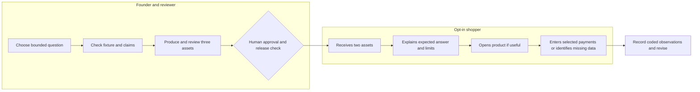
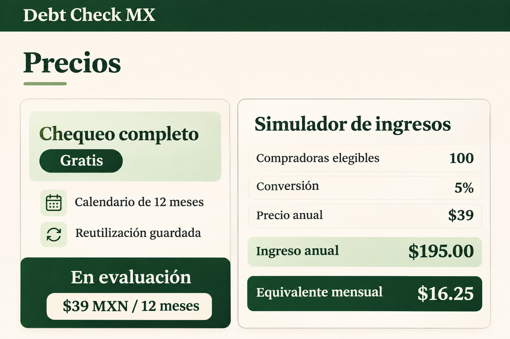
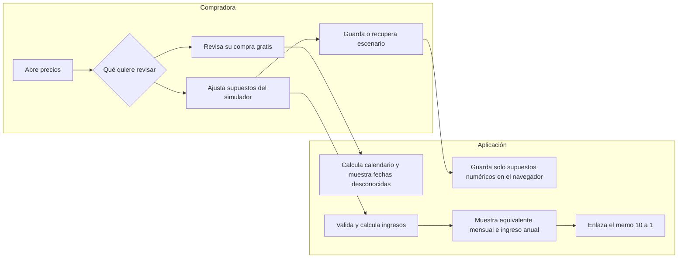

# Week 15 distribution sprint

Ana María Matas | Debt Check MX | 21 November 2026

## Problem and exact first user
An adult in Mexico planning a specific appliance installment offer, with existing installments ending in different months and an unresolved schedule-alignment question. User and potential payer are the individual; willingness to pay is unestablished. The initial purchase check remains free. Reach the shopper during planning with time to consult records, not necessarily at checkout. This moment is operational reasoning, not an observed preference.

## Evidence and success definition
The Charter documents one shopper reporting about 20 minutes in Notes and mental calculation. This is neither a timed baseline nor evidence that schedule alignment caused the effort. Week 15 Brain and shared Blueprint narrow the promise: compare the months of a proposed purchase with payments the user enters. Do not promise affordability, completeness, saved money, or faster decisions.
Sprint success requires six concepts across three series, three finished assets across at least two communication formats, one traceable input-to-output example, mechanical verification, a fresh-chat synthetic persona review, and distribution of two assets to intended users. Publication requires human claim approval and an independent release check; the independent reviewer is unassigned. Human distribution has not started, per founder report on 21 November. This is not zero response: no exposure has occurred yet.

## Scope cut and architecture
Reuse the existing Next.js product, deterministic TypeScript calendar engine, integer MXN cents, validation, and authenticated owner-scoped persistence. Retain existing Supabase controls; no new collection of personal information. This sprint initially changes documentation and creates distribution assets, not calculation or authentication logic. Reuse the public product route as the proposed next action after accessibility verification. No new marketing platform, paid agents, public social account, or bank integration.

## Publication scope authorized on 21 November

Founder requested publication before the fresh-chat persona test. Add /guia with the three labeled fictional assets, accessible text equivalents, input-readiness guidance and the existing /product next action. Update home and navigation to state the selected-payment comparison. No new capture database, tracking, authentication changes, private-data upload or calculation changes. Run build/lint and check deployed /guia, asset routes, home and product; retain original development conversation. Deploy to the existing Vercel project, not a replacement host.

## Brand and Mexico fit
Voice: (1) describe a concrete comparison using plain Mexican Spanish; (2) say exactly which inputs and unknowns qualify the result; (3) leave the purchase decision to the user, without fear, urgency, or approval badges.
Weak: 'Compra tranquilo: descubre si te alcanza.' Revised: 'Compara en qué meses coincidiría esta compra con los pagos que ingreses.'
Reuse cream #F6F3EA, ink #14211C, green #0E5946, mint #CCEBD9, orange #D96B38. Orange marks an unresolved question, not danger; green is a brand color, not financial approval. Titles use Georgia; body uses Arial or a metrically compatible fallback. Visual hierarchy: series label, one question, one evidence panel, coverage statement, one next action. Mobile-readable short text; pesos clearly labeled MXN; installment counts and first payment dates explicit. These are design choices, not tested audience preferences.

## Creative range
| Series | Concept | Status and format |
| --- | --- | --- |
| Antes de comprometerte | La mensualidad no cuenta toda la historia | Produce 3-panel carousel, asset A |
| Antes de comprometerte | Antes de comparar, reúne estos datos | Headline/sketch; connect to required input list |
| Lo que todavía no sabes | Sin fecha no significa sin pago | Produce static explanation card, asset B |
| Lo que todavía no sabes | Confirmado, estimado y desconocido no son lo mismo | Headline/sketch; show distinct states, no certainty claim |
| Del dato al calendario | De tres pagos a una comparación | Produce printable worked-example guide, asset C |
| Del dato al calendario | ¿Tus Notas ya responden la pregunta? | Headline/sketch; compare the whole task, accept Notes when sufficient |

Assets are editorial materials using labeled fictional data, not product screenshots or audience findings. Planned formats are a swipeable carousel, a static card, and a printable guide. The remaining concepts are purposeful sketches, not finished posts.

## One real input through the content method
Input: the existing fictional fixture in lib/domain/engine.test.ts, 'matches the approved fictional Packet fixture', scale 1. A MXN 9,600 purchase, 12 payments of MXN 800 starting 15 January 2027; phone MXN 600 for four months from January; insurance MXN 2,400 in March and September. The fixture also includes an estimated one-time MXN 300 and an undated unknown obligation.
The content example explicitly selects the three known schedules and labels that reduced scope. Known selected totals: January 1,400; March 3,800; September 3,200; 12-month sum 16,800. The estimated 300 is not part of a known subtotal. Omitting it from the teaching example does not convert the full fixture into a complete financial picture. Asset B independently demonstrates a known amount with no date and does not silently place it.
Method: read fixture and scope -> draft one schedule question -> build visual hierarchy -> reconcile labels and arithmetic against fixture/test output -> review plain Spanish and coverage -> revise -> founder and independent review -> share two pieces only after approval. This is a real editorial transformation of a fictional test input, not real-user financial evidence.

## Auditable creative process
| Role | Input | Output | Quality check |
| --- | --- | --- | --- |
| Research | Charter, Brain, Blueprint, fixture, official documentation | Fact/assumption list and chosen question | Source per claim; no invented user behavior |
| Writing | Question and fact list | Spanish headline, explanation, next action | Bounded promise; required work visible |
| Visual production | Approved copy and existing palette | Carousel, card, guide | Mobile hierarchy, readable amounts, color plus labels |
| Evidence/claim checking | Draft plus engine fixture and test result | Claim register and arithmetic reconciliation | No unsupported speed, safety, savings, or validation claim |
| Style review | Checked assets | Consistent Spanish and visual structure | Three voice rules; no fear or false approval |
| Revision | Review findings | Versioned corrected files and change record | Recheck any changed claim or amount |
| Human approval | Assets plus verification evidence | Release/share approval | Ana approves claim; independent release reviewer still unassigned |
Roles describe stages actually documented here; they are not claims of multiple human reviewers or independent AI agents.

## Distribution protocol and honest results
Proposed channel: individual WhatsApp outreach to consenting adults considering a specific appliance installment purchase. Personal/university contacts are recruitment access, not a validated acquisition channel. Do not send messages automatically or collect financial details in group chats. First ask permission, then share assets A and B with the same verified product link. Do not claim measured clicks without instrumentation or direct observation. Capture only participant codes, actual exposure, voluntary replies, observed actions, confusion, and changes; no names, phone numbers, balances, or screenshots of private statements.
Expectation, recorded before outreach: participants can explain that this is selected-payment comparison, identify the next action, and distinguish unknown dates from zero payments. No predicted click-through or conversion rate.
Current results: not run; zero exposures recorded, response and click rates not applicable. Zero response becomes a valid outcome only after documented sharing and a defined observation window. Suggested window: 24 hours after actual sharing; record real timestamps and late replies separately.
Keep/revise decisions must follow actual observations. No adoption, savings, payment, or comprehension result exists yet.

## Test plan and release evidence
Run existing mechanical suite; replay the selected known schedule and unknown-date behavior. Inspect assets for arithmetic, visible fictional-data labels, and working next-action links. Verify home/product without authentication and ensure no private data appears. If a check fails, reproduce, fix, and retest; do not invent a bug. Obtain independent release review before claiming it completed.
A fresh-chat research-grounded synthetic persona session is required separately; preserve the actual original conversation and label it simulation. It does not replace two real audience exposures. No such Week 15 fresh-chat session is completed here yet.
Preserve existing history (at least five commits already exist). Historical links list production and preview deployments, but Week 15 access must be checked. Do not manufacture commits or deploys for a quota.

## Mockup and flow
Reuse docs/MOCKUP_WEEK14.png and assets/DEBT_CHECK_MX_WEEK13_MOCKUP.png as image-generated historical concepts, not new screenshots; provenance in docs/IMAGE_PROVENANCE.md. This sprint's editorial layouts are constructed graphics, not image-generated product mockups.

## Benchmark and local adaptation
Reuse Week 15 Brain research: Notes is the documented workaround; Apple Numbers can align schedules with a prepared sheet; Mobills documents finite installment entries. These mechanisms are not comparative usability findings. For Mexico, preserve MSI counts, supported first dates, cross-year recurrence, MXN, and unknowns. Official statement guidance can identify possible information sources but does not prove ease of entry or customer demand.
References: Banco de México https://comparador.banxico.org.mx/ComparadorCrediticio/terminos-tarjeta-de-credito.jsp ; CONDUSEF statement guide https://sidof.segob.gob.mx/notas/docFuente/5676037 ; competitor references retained in Week 15 Brain. These are inherited references, not newly verified source checks in this sprint.

## Blueprint and shadow conditions
The team confirmed conditional support for investigating schedule alignment, not validated demand. Name mismatch: 'Debt Check' may sound like a financial verdict. Respond with explicit selected-payment scope, exclusions, and unknown-date behavior. Shadow: do not present selected schedules as complete obligations or imply that no overlap establishes affordability. Ana owns claim approval; independent reviewer is unassigned. Whole-task effort and comprehension remain conditions.

## Three-year direction
Retain a reusable Mexican household commitment calendar only if repeated use demonstrates additional value. Preserve confirmation states and traceable corrections. Pricing remains conditional on willingness to pay and service economics, not this campaign's reach. Do not expand into underwriting or financial verdicts.

## Verification completed on 21 November 2026

Existing suite: 45 tests passed across 10 files. Public /product returned HTTP 200. Browser opened without sign-in and replayed the selected known example: January 1,400; March 3,800; September 3,200; horizon 16,800 MXN. The initial unknown-purchase-date state stayed outside the main calendar and displayed provisional options. Coverage warning was visible. This is an assistant-run mechanical/browser check, not independent human review or user validation. Automated date entry required native accessibility controls; no product bug inferred. Three assets were rendered and visually inspected; footer spacing corrected before final export. See output/week15/evidence/VERIFICATION.json.

## Published release

Commit 59883a4 is on origin/main. Vercel deployment dpl_6VAuRm3jLQLkRW4pYxCQ436hMAms is READY. Public guide: https://debt-check-mx-week12.vercel.app/guia ; next action: /product. Build and lint passed. Browser checked local desktop/mobile guide and opened deployed guide and CTA without login. Founder authorized release after assistant checks; independent human review remains unassigned, not silently fulfilled. No audience or persona outcome is claimed.

## Submission and remaining evidence
Final packet must include strategy, brand, six concepts, finished assets or links, process trace, mechanical results, real distribution observations, Blueprint conditions, and decision trail. PERSONA must preserve the fresh-chat synthetic review. BUILDCHAT must be the actual full original development exchange, not this packet or a reconstructed transcript. Demo: 3 minutes showing live workflow and assets, plus 30 seconds explaining what changed the founder's mind. Live and repo links must be checked before submission. Audience sharing, independent review, persona conversation, and founder video remain outstanding.

---

# Previous sprint material retained

# Debt Check MX · Week 14

## Problema y usuario

Una compradora en México quiere ver cómo una lavadora de $12,000 MXN a 12 meses sin intereses se cruza con las mensualidades del celular y el seguro semestral. Una entrevistada reportó unos 20 minutos entre Notas y cálculo mental para una compra. Falta medir cuánto dedica a repetir esa tarea y cuánto ahorra al reabrir un escenario. La usuaria y pagadora de la oferta es la misma persona: una compradora recurrente con otra compra pendiente. La compradora ocasional puede completar la revisión gratis.

## Resultado antes del cierre

En el dominio de entrega, /pricing presenta dos niveles, /pricing permite ajustar y guardar supuestos de ingresos, y /about contiene el memo 10:1. Una persona sin sesión puede abrir estas páginas y completar el chequeo de compra. El test registra una respuesta real al precio y su motivo. La oferta de $39 MXN cubre 12 meses de reutilización y sigue en evaluación. El chequeo gratuito incluye el calendario, los subtotales parciales y las obligaciones sin fecha.

## Mockup

La página muestra ambos niveles, el estado experimental de la oferta y un simulador con controles de volumen, conversión y precio. El boceto agrupa los niveles a la izquierda y el simulador a la derecha. La interfaz final separa ambos niveles en tarjetas para aclarar qué incluye cada uno.

## Flujo

## Benchmark y localización

El brief seleccionó Apple Numbers como comparación directa para reutilizar una hoja y YNAB como referencia de calendario recurrente. Debt Check MX adapta ese flujo a pesos y meses sin intereses, mantiene visible una obligación sin fecha y compara el mismo trabajo con Notas/Numbers durante 12 meses.

## A tres años

Debt Check MX podría convertirse en un calendario reutilizable de compromisos de compra para hogares mexicanos. Cada cambio de fecha o importe conservaría su estado de confirmación. La oferta pagada dependería de que la reutilización ahorre trabajo medido y sostenga el costo de servicio.

## Alcance

El lanzamiento incluye contenido público, simulador, escenarios numéricos locales y memo. El experimento de reutilización de calendarios requiere verificar por separado el guardado con sesión de Week 13. Quedan fuera el cobro en línea, la sincronización bancaria y las estimaciones de riesgo sin observación.

| Componente | Implementación |
| --- | --- |
| Sitio | Extender el proyecto Next.js existente |
| Cálculo | Compradoras elegibles en 12 meses × conversión × precio de 12 meses. Dividir entre 12 para equivalente mensual |
| Escenarios | Guardar entradas numéricas validadas en el navegador |
| Datos personales | Mantener autenticación y RLS para calendarios privados del producto |
| Economía del servicio | Restar adquisición, onboarding, soporte, correcciones y excepciones del precio para estimar contribución. Registrar costos antes de afirmar margen |

## Pruebas

- Revisar /pricing, /about, /product y enlaces de evidencia sin sesión. Verificar el dominio de entrega.
- Con 100 compradoras, conversión hipotética de 5% y $39, esperar $195 anuales y $16.25 mensuales equivalentes. Probar cero, límites, valores inválidos y recuperación tras recargar.
- Repetir lavadora/celular/seguro en Notas o Numbers y en el producto con el mismo encargo. Cronometrar creación y reutilización por separado. Verificar 12 cargos y subtotal parcial mientras falta la primera fecha.
- Hacer prueba de persona sintética con capturas y registrar un punto de confusión, cambio y verificación.
- Entrevistar a una compradora potencial. Registrar oferta, respuesta, razón y decisión. Una respuesta verbal no cuenta como pago.

## Regla 10:1

$39 × 10 = $390 MXN de beneficio incremental en 12 meses. Beneficio = horas ahorradas × valor por hora + costos directos evitados + pérdidas evitadas respaldadas por evidencia, sin duplicar rubros. Como sensibilidad, a $120 MXN por hora supuestos, se requieren 195 minutos ahorrados al año si todo el beneficio viene del tiempo. Los 20 minutos reportados describen el proceso actual para una compra y el ahorro sigue sin medirse. Si la reutilización no mejora el proceso habitual o la compradora rechaza la oferta porque el chequeo gratuito basta, registrar el motivo y replantear el cobro.

## Week 15 persona report received

Founder supplied a synthetic walkthrough reporting live-page inspection and the fictional example outputs, matching 1,400 / 3,800 / 3,200 / 16,800 MXN. With an undated 300 payment, it reports partial status and unchanged known subtotal; without the proposed purchase date, it reports 7,200 MXN of known existing obligations and provisional options. These are claims in the supplied synthetic session, not new human evidence. Preserve its exact text at output/week15/evidence/PERSONA_WALKTHROUGH_ORIGINAL.txt; obtain the full original chat link/export separately.

No calculation failure was reported. A modeled hesitation concerns the global status 'Completo' implying complete finances or approval. Preventive response: show 'Completo para los datos ingresados' for the global complete state and retain the affordability exclusion beside it. Monthly state labels and engine states stay unchanged. Run build/lint and verify the published label; synthetic persona comprehension retest and real human comprehension remain pending. This is a precautionary clarification, not a claim of fixing a reproduced bug.
