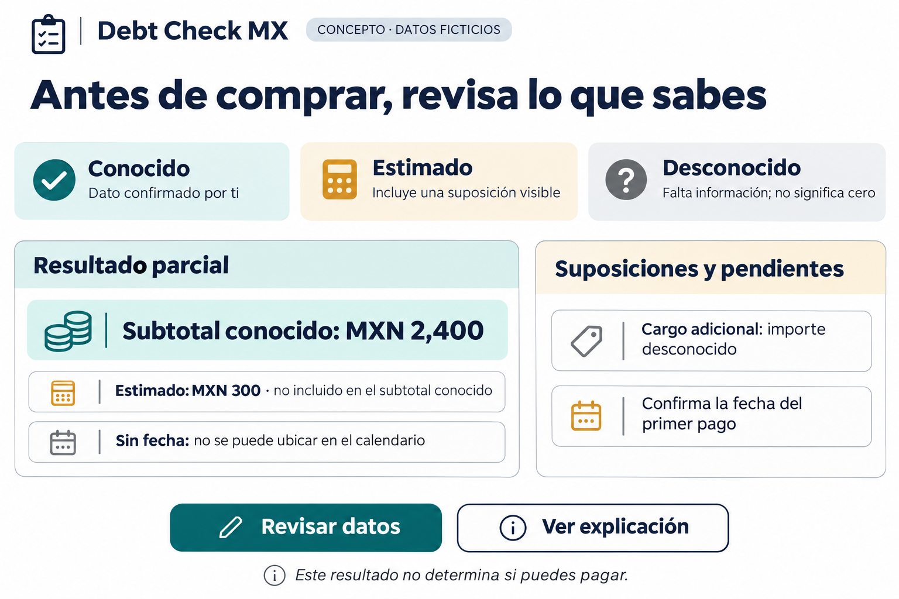
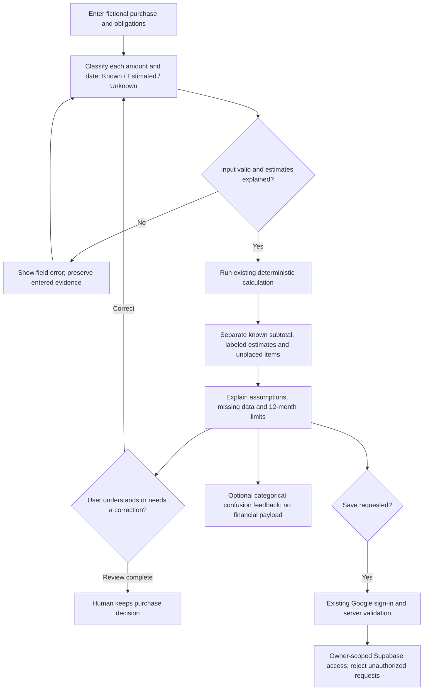
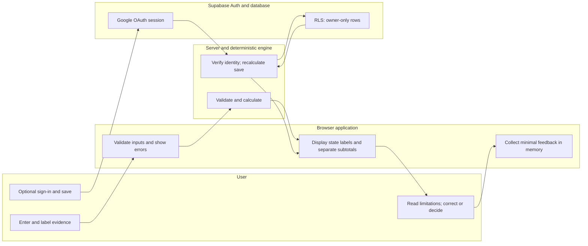

# Debt Check MX — Week 13 Packet

**Student:** Ana María Matas · **Role:** Technologist · **Professor:** Ramsey  
**Date:** 6 November 2026 · **Version:** D2 · **Status:** Ready for founder review; application implementation NOT approved.

## 1. Authority, evidence and approval boundary

This Packet uses the Week 13 Business Bending instructions and Crystal Ball Brief supplied by the founder as original professor text in this chat, the preserved Team 5 Blueprint, the Week 13 individual Brief, the existing Product Charter and local source/documentation. The supplied professor text is authoritative for planning; no independent LMS verification is claimed. Private source copies and SHA-256 hashes are held outside Git.

The Blueprint PDF still says “SIMULATED DRAFT — PENDING ACTUAL TEAM APPROVAL.” The founder subsequently reports team approval. Both facts are preserved in `BLUEPRINT_APPROVAL_RECORD.md`; no vote, meeting date or unanimity is invented. The original identifies Ana María's individual declaration as improving Debt Check MX's known, estimated and unknown payment handling and comparing comprehension with a spreadsheet. Agua en seguimiento remains the team's primary vacuum, not this individual build.

This is a documentation-only gate. Do not change application code until the founder explicitly approves this Packet version. External push, deployments, production configuration and Supabase operations require separate authorization. Preserve the existing Week 12 `docs/PACKET.md`; after approval, archive its original bytes and place the approved Week 13 Packet at the repository's required `docs/PACKET.md` location. The current review copy is under the Week 13 evidence deliverables, not yet substituted into the repository.

**Weekly LLM Project — NOT VERIFIED.** The available records do not establish that the original Packet conversation was opened inside the same weekly LLM Project used for Brain Bending. Open that Project and check whether the original Packet conversation appears there as a separate conversation. Record its project and conversation identifiers or a screenshot showing both. If the conversation is absent, satisfying the requirement will require a new conversation inside that Project, subject to explicit authorization.

## 2. Problem, exact user and individual declaration

An adult in Mexico is considering an installment purchase while already carrying other payment commitments. A calendar may look precise even when a value or date is estimated or unknown. The risk is misunderstanding what the numbers support, not simply failing to calculate a sum.

The first test population is Spanish-speaking adults in Mexico who have considered an installment purchase and can enter a fictional purchase plus existing obligations themselves. They may currently use a spreadsheet or Notes. Recruit five real target users outside the class; at least three must be strangers to Ana María, and none should be recruited only to provide friendly approval. Record role and relevant experience, not names in deliverables.

**Individual declaration:** Improve Debt Check MX's handling of Known, Estimated and Unknown payments, then compare user comprehension against an organized spreadsheet using equivalent fictional tasks.

No demand, willingness to pay, 10:1 improvement or financial outcome is established by this declaration. The Charter's individual history is background, not a demo dataset or a population baseline.

## 3. Success definition and decision rules

Before the module closes, the approved slice must work at the verified real-domain URL: users can distinguish confirmed information from estimates and missing information, explain the limits of a subtotal, and correct an input without losing its evidence state. Google authentication and owner-only storage must remain intact where personal scenarios are stored.

Proposed acceptance targets are **targets, not results**:

| ID | Acceptance criterion | Evidence required |
|---|---|---|
| S1 | Known, Estimated and Unknown appear as text beside relevant amounts/dates, not color alone. | Source tests, keyboard walkthrough and real screenshots. |
| S2 | A monthly known subtotal includes only amounts AND placement dates marked known; an estimate is separately labeled and never silently promoted. | Deterministic fixtures and UI/API agreement. |
| S3 | Unknown remains null/unplaced when timing is missing; confirmed zero remains distinguishable from unknown. | Regression tests and observed explanation task. |
| S4 | Assumptions remain visible and survive authorized save/reopen; old saved versions are handled explicitly. | Version/serialization tests and authorized two-account verification. |
| S5 | At least 4 of 5 users independently answer every critical comprehension question correctly after the verified fix. | Individual task records and exact denominators; exploratory small-sample evidence only. |
| S6 | The app improves paired comprehension versus the spreadsheet without creating a new critical misunderstanding. | Paired score table, order allocation, assistance/time records and negative results. |
| S7 | The #1 verified human pain is fixed, redeployed and retested; one genuine return signal is documented. | Before/after records, deployment/commit mapping and original message, signup or revisit. |
| S8 | Security floor passes and the real domain loads the tested build; minimum five meaningful commits and two real deployments exist. | Technical evidence and live checks, not promises or historic counts alone. |

A critical error means treating an unknown payment as zero or absent, treating an estimate as confirmed, or interpreting the result as purchase/affordability approval. A task passes only if all critical questions are correct without coaching. Do not exclude incomplete tasks to inflate a percentage. Report numerator/denominator and assistance separately.

If the spreadsheet matches or exceeds comprehension and effort, preserve that result and reconsider whether the custom slice is justified. A 4/5 outcome is a descriptive result for these five people, not a general success rate. Report any speed ratio only for equivalent completed tasks; do not claim 10:1 from these targets.

## 4. Proposed image-generated mockup

Generated with the built-in image-generation tool on 6 November 2026. It is a design concept, not a screenshot or evidence of a working feature. The labels and amounts are fictional. `IMAGE_PROVENANCE.md` records the prompt and source asset.

The concept separates known and estimated amounts and lists unknown timing. “Known” means confirmed by the user for this scenario, not verified by a bank. The illustrated amounts are independent design examples; the evaluation fixtures below have their own reference answers.

## 5. Feature flow — Mermaid

## 6. Actor swimlane — Mermaid

There is no AI actor in the financial engine. The synthetic persona is a testing activity, not a runtime financial adviser. The browser may calculate locally for immediate display; the server must validate and recalculate every saved scenario.

**Mermaid rendering — NOT VERIFIED.** A local static check confirmed the flow directions, balanced swimlane boundaries and declared edge endpoints in both unchanged source blocks. A Mermaid engine was unavailable for reliable validation. The PDF contains separately drawn reference views and the Mermaid source.

## 7. Global benchmark and Mexican localization

**Benchmark line:** The strongest existing reference selected for this slice is YNAB's scheduled-transactions workflow: its official guide documents recurring transactions, including every-six-month schedules. This is a research choice, not a proven global ranking or a hands-on claim that YNAB lacks uncertainty support. [YNAB official guide](https://support.ynab.com/scheduled-transactions-a-guide-BygrAIFA9?mobile-help=true)

**Difference/localization line:** Debt Check MX will focus on Spanish, MXN and pre-purchase installment comprehension, keeping user-confirmed, estimated and unknown payment information visibly distinct and testing that interface against a spreadsheet.

Borrow clear recurring schedules and reviewable upcoming commitments; do not claim scheduling is novel. The official guide was retrieved through web search; direct page opening returned no readable body. The benchmark is desk research, not a completed competitive usability test.

For Mexico, label meses sin intereses only when supplied by the fictional scenario; do not infer fees or a first card-payment date. CONDUSEF distinguishes the statement cutoff from the payment deadline. This supports asking for a confirmed first payment rather than treating the purchase date as a bank-confirmed schedule. No universal issuer timing rule is encoded from that general explanation. [CONDUSEF educational guide](https://www.condusef.gob.mx/documentos/299134_Cr_dito-2018.pdf)

Localization decisions are design choices to test, not proof that comparable Mexican tools are absent. The spreadsheet is the primary practical comparator for the individual declaration.

## 8. Three-year vision — three sentences

In three years, Debt Check MX could become a trusted pre-purchase comparison tool for adults in Mexico who use installments. It would help people understand supported payment overlaps, visible assumptions and unresolved commitments without connecting to bank accounts or making purchase decisions for them. Expansion would follow demonstrated comprehension gains, secure handling of saved scenarios and evidence that people choose to return.

## 9. Smallest justified scope and cuts

**Read-only source finding:** `lib/domain/engine.ts` currently adds every non-unknown amount to `knownSubtotalCents`, including estimated amounts; its complete/partial checks do not separately treat estimated dates as uncertainty. The results UI displays the amounts without their per-item evidence labels. This is a source-level finding, not a newly executed browser reproduction or an already fixed bug. Preserve the present behavior as the baseline, reproduce it after approval and decide the smallest coherent correction.

Proposed work:

1. Define and test the known/estimated/unknown result contract. Keep evidence states on both amount and date. A known amount on an estimated date is not part of a confirmed monthly subtotal.
2. Correct the subtotal/result presentation and only the calculation logic needed for that contract. Show estimates separately, expose assumptions and keep unplaced obligations visible. Do not silently redefine old saved snapshots.
3. Preserve safe save/reopen behavior with explicit calculation/schema version handling. Prefer compatible code-only changes; any database migration requires a separate plan and authorization.
4. Add a minimal categorical feedback/event mechanism that does not transmit financial inputs, names or authentication data.
5. Use five real sessions and the spreadsheet comparison to select the smallest subsequent fix, then retest and redeploy when authorized.

**Not building:** bank integrations, automatic statement import, credit/affordability scores, payment recommendations, automated first-card-date inference, a general budget app, reminders, a new auth provider, new dashboards, payment processing, billing, speculative Guest Mode, or a new database simply to collect analytics. No switch to Agua en seguimiento. No cosmetic rebuild or generative financial engine.

## 10. Architecture and stack

| Layer | Existing choice | Week 13 boundary |
|---|---|---|
| UI | Next.js 16.4.1, React 19, TypeScript | Reuse forms/results; add accessible evidence labels and review copy. |
| Domain | Pure deterministic functions, integer MXN cents, 12-month horizon | Preserve recurrence and null semantics; change only demonstrated uncertainty defects. |
| Validation | Zod on client/server boundaries | Retain length/type/range checks, bounded requests and assumption requirements. |
| Authentication | Supabase Auth, Google OAuth, SSR cookies | Preserve architecture; no auth replacement. |
| Persistence | Supabase owner-scoped scenarios, stored input/result versions | Verify RLS and version compatibility; no unsupported privacy claims. |
| Hosting | Existing Vercel project; existing GitHub repository | Free tiers only; inspect current limits before any authorized deployment. |
| Tests | Vitest, TypeScript, ESLint; existing pgTAP plan | Reuse suite and add focused regressions after approval. |
| Feedback | Proposed bounded in-memory categorical event log | No new external analytics dependency or table required. |
| Evidence | Existing Week 13 Evidence Kit | Private native archives; reviewed exports only in deliverables. |

Repository: `https://github.com/anamariabuilds-source/debt-check-mx-week12`. User-supplied hosted URL: `https://debt-check-mx-week12.vercel.app/`. The Vercel URL is not claimed to meet the professor's **real-domain URL of record** requirement. The actual custom domain, DNS, active deployment, environment and current plan limits remain unverified and require an authorized external verification step.

## 11. Security floor and feedback mechanism

| Professor floor | Existing evidence | Required release check |
|---|---|---|
| No secrets in code/repo | Environment files ignored; no browser service-role reference in prior audit | Scan tracked files and full Git history locally; record only redacted findings. Confirm production variable scope when authorized. |
| Google auth for personal storage | OAuth and server session checks implemented; earlier founder observations | Sign-in/out, expired sessions and owner identity verified with dedicated test accounts. |
| RLS on personal tables | Migration and pgTAP plan prepared | Authorized anonymous + owner A + owner B read/list/create/update/delete tests. Prove another owner's rows cannot be accessed or changed. |
| Every form validates input | Existing Zod, length/type bounds, server recalculation | Boundary and malformed requests, oversized inputs, null/zero, rejected redirects and mutation origin checks. |
| Fictional demo/seed data | Protocol requires invented scenarios | Inspect screenshots, video, logs and exports for real names, accounts, secrets or finances before release. |

Do not infer live RLS enforcement from SQL files. Previous local results and founder-observed login/save do not prove current production isolation. A critical leak blocks release and must be fixed before grading; the professor specifies a 7/10 cap for a failed floor item and 5/10 for exposed secrets or leaked real personal data.

Proposed feedback: a visible “Report confusion” control with categories such as evidence label, date, subtotal, save, or other, without free-text financial details. Keep a bounded session-memory event list (maximum 100), with allowlisted event names, category and time only; never include amounts, dates entered in forms, titles, names, email, tokens or request bodies. Export a local JSON file only when the tester explicitly chooses; no automatic network transmission or production storage. This is a feedback mechanism, not an adoption dashboard. State that unsaved events disappear on reload; the observer records test files privately. Test event shape, limit and absence of sensitive fields, and inspect network activity before claiming no transmission.

## 12. Mechanical test plan and actual-bug procedure

After Packet approval, record the baseline commit, start the observer and run commands through the kit's `run` wrapper so exit codes and full stdout/stderr are retained. Sequence: `npm test`, `npm run lint`, `npm run build`, then `npm run typecheck`; build and typecheck must not race generated Next types. Run `npm audit --omit=dev` as a registry/network check only when access is authorized. Do not install or upgrade dependencies simply to erase an audit finding.

| Test | Expected evidence/result | Initial Week 13 status |
|---|---|---|
| M1 Known vs estimated amount | Separate confirmed and estimated subtotals; no implicit promotion | Not run |
| M2 Known amount, estimated date | Clearly provisional placement; assumption visible | Not run |
| M3 Unknown amount/date vs confirmed zero | Null remains unknown; zero remains a real supported value | Not run |
| M4 Recurrence and boundaries | Monthly/semiannual, month-end/leap, 12-month horizon and beyond-horizon warnings preserved | Existing historical coverage; rerun pending |
| M5 Saved scenarios and versions | Known/estimated/unknown and assumptions round-trip; legacy snapshot behavior explicit | Not run |
| M6 Auth/RLS | Logged-out denial, A-owned CRUD, B isolation, no client-selected owner | External authorized execution pending |
| M7 Forms and request security | Length/type/range, origin, body bounds and redirect checks | Rerun pending |
| M8 Keyboard/mobile and meaning | Text labels, readable focus/errors; no color-only states | Not run |
| M9 Feedback privacy | Allowlist enforced; no financial/auth payload; bounded events | Not implemented |
| M10 Release smoke | Real domain, calculation, login/save/reopen, correct build/commit | Deployment authorization pending |

For an actual bug, preserve: expected behavior, exact synthetic steps, actual output, source commit, screenshot/log and a failing regression where appropriate. Then record the smallest fix, passing focused/full checks and the deployment that contains it. The estimated-subtotal finding is a candidate for this process; do not label it runtime-reproduced yet. Do not introduce a defect intentionally or present a historic Week 12 fix as a new Week 13 cycle. If no bug is reproduced, record that honestly and continue targeted testing rather than manufacture one.

## 13. Five-real-human and spreadsheet protocol

Recruit five real target users, with at least three strangers and no classmates as substitutes for target users. Use IDs U01–U05 and roles, not names, in academic evidence. Keep contact details and any consent records separate/private. Explain that this is a student test, not financial advice; use fictional tasks only, allow stopping at any time, and request recording permission separately. Do not collect bank statements, card numbers, income or personal debt details.

Use the same device class, instructions, time window and information for both tools. Prepare an organized spreadsheet with labels for amount/date evidence state, assumptions, recurrence, known-only subtotals, labeled estimated amounts and unresolved items. It must not be a deliberately weak comparator. Verify its formulas against the reference answers before any user session and preserve its file/hash. Spreadsheet creation and evaluation are planned, not claimed complete in Stage D.

### Technologist’s opening position on the provocation

This is my position before user testing. It does not report completed sessions or their results.

> I mostly agree that if all five users liked the application, we may have tested politeness rather than real usefulness. However, five positive reactions do not automatically invalidate a test. The important evidence is whether users can independently complete the task, identify overlapping payments, and explain what remains uncertain. I would rather discover five serious misunderstandings than receive five compliments. Our job is to fix the most important verified problem, not the easiest or most flattering one.

### Fictional equivalent cases and reference answers

Use January–December 2027. No data below belongs to a participant.

| Item | Case A | Case B |
|---|---|---|
| Proposed purchase, known | MXN 9,600, 12 × 800, first payment 2027-01-15 | MXN 14,400, 12 × 1,200, first payment 2027-01-15 |
| Existing monthly obligation, known | 4 × 600, January–April | 4 × 900, January–April |
| Semiannual obligation, known | 2,400 in March and September | 3,600 in March and September |
| One-time estimate in January | 300; assumption: fictional supplier estimate | 450; same type of fictional assumption |
| Unresolved charge | Amount and date unknown; not silently zero | Amount and date unknown; not silently zero |

Reference answers: A has January known subtotal 1,400 plus a separately labeled 300 estimate; March 3,800; known 12-month total 16,800. B has January known subtotal 2,100 plus a separately labeled 450 estimate; March 5,700; known 12-month total 25,200. Both remain partial because an unresolved charge could affect the interpretation. Totals with estimates may be shown only as clearly provisional, never as confirmed complete obligations. Unknown values cannot be inferred from the totals.

Before sessions, verify these reference answers independently and with approved tests; the arithmetic is a protocol specification, not a recorded app result. Add a transfer question: if the first purchase date becomes unknown, its purchase payments must remain unplaced; do not invent January placement.

### Counterbalanced assignment

U01: App/A then Spreadsheet/B. U02: Spreadsheet/A then App/B. U03: App/B then Spreadsheet/A. U04: Spreadsheet/B then App/A. U05: App/A then Spreadsheet/B. Record the unavoidable 3/2 order imbalance and prior spreadsheet experience. Use a brief identical neutral orientation, reset fixtures between tools and do not teach the answers between tasks.

Task prompts: enter the fictional data; identify the largest supported overlap; explain January's subtotal; state which amount is estimated and its assumption; explain what the unknown charge permits or prevents concluding; identify the next information to verify. Do not score “buy” or “do not buy” as correct. Ask the participant to explain “complete/partial” in their own words.

Observe without coaching. Start time at first entry and end when the participant gives the final explanation, including data entry and review. At 12 minutes stop and record incomplete, not an invented completion time. Record every intervention, error, hesitation, abandonment and exact quote with timestamp. Separate observation from interpretation and from the participant's statement.

Score four critical questions: (1) supported overlap and amount, (2) estimates and assumptions, (3) unknown is not zero/absence, (4) no affordability approval. Record 0–4 per tool and all-four pass/fail. Report paired differences, task completion, median time among comparable completed tasks, individual timings and assistance. Do not drop failures from the main denominator or claim statistical significance from five users. If time improves but misunderstanding worsens, do not call the slice successful.

### Pain ranking, correction and return evidence

Rank the three worst findings by threat to the proposed value case: severity of misunderstanding/loss, independent recurrence, task blocking and added effort. Preserve the exact quote and observed action for every ranked finding. Use severity (1–3), affected participants (count, not repeated quotes) and task impact as transparent inputs; explain tie-breaking. A one-person security or false-certainty failure can outrank a frequent cosmetic issue.

Fix the #1 verified pain, capture before/after on the same fictional case, redeploy with permission, and retest the affected task with the original participant where possible and an uncoached other target user. Record unresolved pain and regression failures. If the fix differs from the easy change initially preferred, explain why.

Obtain one genuine return signal: a participant's unprompted or neutrally elicited message, voluntary signup or later repeat visit. Preserve the original message/event and context, redact identity in the submission, and distinguish stated intent from an actual return. A courteous “yes” to a leading question is not sufficient. Optional follow-up after 48–72 hours requires consent; do not fabricate a visit if nobody returns.

Session record fields: ID/role; stranger status; consent/recording status; date/device; tool/case/order; task attempt; actions and quotes; score/time/assistance; pain IDs; screenshots; build/commit/deployment; retest and return-evidence links. All five records start empty.

## 14. Persona Test — Layer 1

Run a fresh synthetic-user chat after a real working screen sequence is available and before the real-user sessions. Use an explicitly hypothetical composite grounded in the Charter: an adult Spanish-speaking installment buyer who uses Notes/spreadsheets, wants to understand uncertainty, and may stop when instructions become unclear. Do not invent age, disability, education or research facts and present them as observed.

Fresh-chat prompt:

> You are a synthetic test participant, not a real research participant. You are an adult in Mexico considering the fictional installment purchase provided by the facilitator. You use Notes or a spreadsheet and do not know this app. Attempt only what is visible in each screenshot, state what you would do next, and say when you are uncertain or would stop. Do not infer hidden screens, successful clicks, bank facts or a successful save. Keep your original responses, including mistakes. This exercise does not replace real-user evidence.

Capture screenshots from the actual approved build: start/fictional label; purchase input; obligation states; validation error; result summary; item details/assumptions; unplaced items; optional authenticated save/reopen. Paste them in order with “What do you understand, what would you do next, and where are you confused?” Preserve the exact prompt, screenshot hashes and simulated responses. Do not substitute the generated mockup for working-app screenshots.

Log every confusion/hesitation/failure with screen ID and exact response; select the most serious issue, fix it after evidence review, and retest the same task. Mark all findings synthetic. Produce PERSONA_AnaMariaMatas.pdf only from the real fresh-chat record. If a fresh chat cannot be executed, deliver the exact prompt and ordered screenshots for Ana María; record “not executed,” not a fabricated test.

## 15. Blueprint conditions, dissent and Shadow Clause

| Condition | Debt Check MX treatment |
|---|---|
| 1 Real user value | Five real sessions, at least three strangers; actions, mistakes, effort and comprehension outrank praise. |
| 2 Technology justified | Directly applies to Ana María's declaration: compare with an organized spreadsheet and retain negative/equal results. |
| 3 Economic case | Do not claim commercial viability or 10:1; potential payer remains unverified. No sales feature added. |
| 4 Operational reliability | Repair-case ownership workflow is not implemented here. Adapt its principle to an explicit evidence owner (Ana María), next action and retest date for every open finding. Do not transplant repair-specific thresholds as proven finance requirements. |
| 5 Shadow Clause | Original repair clause requires dated family confirmation and visible contradictions. Proposed individual analogue: calculations, estimates or saves do not verify financial facts; preserve uncertainty and contradictions, require review instead of a false-confirmed state. This adaptation awaits Packet approval. |
| 6 Evidence-based iteration | Rank failures, apply smallest justified correction, retest and reconsider custom software if the spreadsheet performs equally well. |

Preserve Ana María's dissent that a specialized interface may improve comprehension despite commodity arithmetic; test it rather than assume it. Do not erase the original team's unresolved economic and operational concerns. Founder-reported team approval does not imply user validation.

The Crystal Ball Brief additionally requires **The User Panel Debrief**, a team round-robin video. Bring the most painful authentic quote and its verified fix; ask whether it addressed the real pain or the easy pain. Prepare roles and evidence references, but the real team conversation/video must be supplied or recorded, never simulated as completed.

## 16. Implementation prompt and meaningful milestone plan

After explicit approval, use this build instruction:

> Work in the existing Debt Check MX Week 12 repository. Read the approved Week 13 Packet and repository instructions. Start the existing evidence observer for the actual session. Preserve a baseline and reproduce the estimated-subtotal finding with fictional fixtures. Implement only S1–S4 and the minimal allowlisted feedback mechanism, with focused regressions and explicit saved-version compatibility. Keep Google Auth, server validation and owner-scoped storage. Run the mechanical sequence, document actual failures and fixes, and prepare reviewed release evidence. Stop before external push, deployment, production/Supabase changes or any unapproved schema change. Do not claim human testing, privacy or deployment success without direct evidence. After the five human sessions, fix the highest-priority verified pain, retest and prepare the next authorized release.

Proposed meaningful commit milestones, only when actual work warrants them:

1. Approved Packet, source/approval record, test protocol and baseline evidence.
2. Reproduced uncertainty defect, coherent domain/result correction and its regression tests.
3. Accessible evidence-state/assumption review experience with save/reopen compatibility checks.
4. Minimal feedback mechanism with privacy tests and documented mechanical verification.
5. Highest-priority verified user-pain correction, retest and release evidence.

These are planned milestones, not existing commits. Keep coupled changes together; do not split identical changes to manufacture five commits. If work does not naturally reach the minimum, report the gap and identify a genuine remaining requirement. Do not count Week 12 history as five new Week 13 commits without explicit professor acceptance.

## 17. Deployment, session close and submission evidence

Plan at least two genuine, authorized deployments. Release 1 is the working baseline for screenshot/persona/human evaluation after mechanical checks. Release 2 contains the verified highest-priority human fix and any remaining real mechanical/persona correction, with before/after and retest evidence. If a mechanical defect needs an additional release, perform one when authorized rather than manufacture a two-release narrative. A defect fixed before any deployment does not establish a redeploy cycle by itself.

For each release record: local and UTC timestamp, full commit SHA, deployment ID, immutable deployment URL, real-domain alias, environment, change/pain IDs, test artifacts and verified URL result. Check the real domain after promotion; local tests and “deployment ready” alone do not establish the URL works. The professor states a non-loading real-domain URL makes the deliverable score zero. Do not claim current production success in this Packet.

Every session closes with the existing kit, reviewed DECISIONS.md entries, tomorrow's first move, Git status and evidence hashes. The professor requests commit/push at close, but the founder's approval boundaries prevail: Stage D makes no commit/push, and any future external push waits for explicit authorization. Record pending actions instead of pretending they occurred.

| Submission | Planned source and acceptance | Current status |
|---|---|---|
| PACKET_AnaMariaMatas.pdf | Approved pre-code Packet, mockup, diagrams and requirement mapping | Review version prepared; approval pending |
| PERSONA_AnaMariaMatas.pdf | Authentic fresh synthetic-chat log, screens, worst confusion/fix/retest | Not executed |
| BUILDCHAT_AnaMariaMatas.pdf | Native session records, cutoff, completeness, redactions and hashes | Existing exporter ready; final export later |
| DEMO_AnaMariaMatas.mp4 | Authentic live-URL footage: 3 minutes walkthrough + 30 seconds “what changed my mind” | Recording pending; no synthetic replacement |
| Live real-domain URL | Verified working approved build at URL of record | Domain/production verification pending |
| GitHub URL | Existing repository and meaningful current-week history | Local remote known; push/history verification pending |
| Five-user evidence and ranking | Role-only records, exact quotes/actions, three strangers, top three pains | Not collected |
| Before/after, #1 fix and return proof | Same fictional task, genuine releases/retest and original return signal | Not collected |
| Commit/deployment manifest | At least five meaningful commits, two real deployments, SHA/ID/URL mapping | Planned, not achieved |
| Team User Panel Debrief | Authentic round-robin video with painful quote and fix | Team participation pending |

The rubric allocates 4 points to working URL, 2 to pre-code Packet, 2 to honored Blueprint/Shadow conditions, 1 to test-fix-redeploy and 1 to transcript depth. These are requirements, not a self-awarded grade. Free stack and the security floor apply throughout.

## 18. Approval requested and unresolved verification

Approve or revise the proposed scope, success targets, test protocols and explicit Debt Check MX Shadow adaptation. Before implementation, verify the required same-weekly-Project conversation context and establish the real domain to be used later. Existing runtime security and current production state remain verification tasks, not assumed guarantees.

The application has not been changed for this Packet. No participant, quote, bug reproduction, test pass, commit, deployment, return visit or video has been fabricated. After approval, implement only the approved scope; stop for consequential external permissions and genuine human participation as needed.

## Sources

- Professor Week 13 Business Bending instructions and Crystal Ball Brief: original text supplied by Ana María in this chat on 6 November 2026; private original-message records retained.
- `Blueprint 13_team5.pdf`: original three-page PDF preserved unchanged; subsequent approval recorded separately.
- `BRIEF_AnaMariaMatas.pdf`: two-page Technologist brief; its screenshot-supported capability claims are not independent live verification.
- Debt Check MX `docs/CHARTER.md`, `docs/TEST_TRACEABILITY.md`, `docs/SECURITY.md`, and read-only source inspection at HEAD `f0e8e51f05c718a281e7313a9f8ebcf3879ca480`.
- YNAB official scheduled-transactions guide and CONDUSEF educational material linked in Section 7; retrieved 6 November 2026. Feature/market claims are restricted to the evidence stated there.
